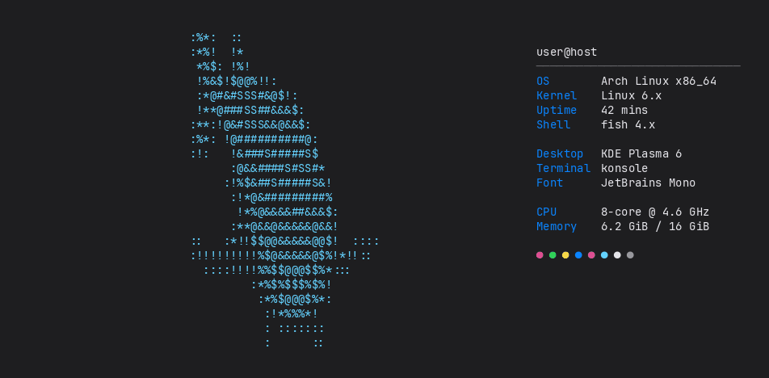

# fishfetch

[fastfetch](https://github.com/fastfetch-cli/fastfetch), but the logo is an animated fish.



fishfetch runs fastfetch with a blank logo, then plays the
[ascii.live](https://ascii.live) fish in that space for a few loops and settles
on the first frame. Press any key to stop it early; the key still reaches your
shell, so you can just start typing.

It's plain text, so it works in any terminal, including over SSH. With `--gif`
it can play a GIF as an image instead (sixel, or kitty's graphics protocol in kitty).

## Install

Needs Python 3.10+ and fastfetch. `--gif` also needs ImageMagick 7 and a
terminal with sixel or kitty graphics support (Konsole, kitty, WezTerm, foot, …).

```sh
git clone https://github.com/Waysel07/fishfetch
cd fishfetch
./install.sh                     # ~/.local/bin + ~/.local/share/fishfetch
# or system-wide:
sudo PREFIX=/usr/local ./install.sh
```

Or run it straight from the clone: `./fishfetch`.

Uninstall with `./install.sh --uninstall`.

## Usage

```sh
fishfetch                    # 3 loops, any key stops
fishfetch -l 0               # loop until a key is pressed
fishfetch -l 1               # one loop, nice as a shell greeting
fishfetch -c ff9f0a          # orange fish
fishfetch --gif my.gif       # play a GIF as the logo
fishfetch -- --structure Title:OS:Kernel:Uptime   # anything else goes to fastfetch
```

Your normal fastfetch config is used for everything except the logo.

On narrow terminals the fish moves above the info instead of wrapping into it,
and if the output is taller than the window it only animates the part of the
fish that's still on screen.

### As a shell greeting

fish (`~/.config/fish/config.fish`):

```fish
function fish_greeting
    fishfetch -l 1
end
```

bash/zsh (`~/.bashrc` / `~/.zshrc`):

```sh
[[ $- == *i* ]] && fishfetch -l 1
```

## Credits

- The fish animation is from [hugomd/ascii-live](https://github.com/hugomd/ascii-live)
  (GPL-3.0). `tools/update-frames.py` regenerates `frames/` from its source.
- Uses [fastfetch](https://github.com/fastfetch-cli/fastfetch) for the system info.

## License

GPL-3.0-or-later, see [LICENSE](LICENSE).
